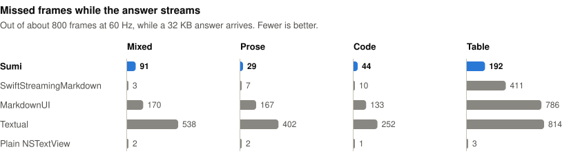
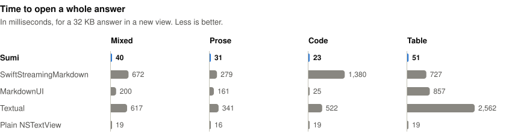

# Sumi

[](https://github.com/Axenos-dev/Sumi/actions/workflows/ci.yml)
[](https://swift.org)
[](https://developer.apple.com/macos/)
[](https://swift.org/package-manager/)
[](LICENSE)

Sumi is a light and fast library to render static and streaming Markdown for Mac apps, written in Swift.

https://github.com/user-attachments/assets/a69af195-b103-4409-83c0-fac5596bf8db

## Installation

Sumi needs macOS 26 and Swift 6.3. Add it to `Package.swift`:

```swift
.package(url: "https://github.com/Axenos-dev/Sumi.git", from: "0.1.0")
```

```swift
.product(name: "Sumi", package: "Sumi")
```

It uses [swift-markdown](https://github.com/swiftlang/swift-markdown) to parse, [Highlightr](https://github.com/raspu/Highlightr) to highlight code, and [SwiftMath](https://github.com/mgriebling/SwiftMath) to draw formulas.

## Usage

`MarkdownText` shows Markdown as selectable text:

```swift
import Sumi
import SwiftUI

struct MessageView: View {
  let text: String

  var body: some View {
    MarkdownText(text)
  }
}
```

To stream, give `MarkdownText` the whole text so far on each update. Its going to be fast when new text only adds to the end, like a LLM's response.

The text uses the font of the environment, and follows the light or dark appearance of the app. Clicks on links go to the `openURL` action of the environment:

```swift
MarkdownText(text)
  .font(.system(size: 15))
  .environment(\.openURL, OpenURLAction { url in
    // Open the link in your app.
    return .handled
  })
```

## Customization

### Style

The default look is close and inspired by the Codex app. To change some values, use `markdownStyle`, and the values that you don't change keep their defaults:

```swift
MarkdownText(text)
  .markdownStyle { style in
    style.lineSpacing = 4
    style.link.color = .blue
    style.link.isUnderlined = true
    style.codeBlock.theme = CodeTheme(light: "github", dark: "github-dark")
    style.table.showsRowLines = false
  }
```

`MarkdownStyle` has values for the body text, headings, links, inline code, code blocks, tables, quotes, lists, and math. Code colors use [highlight.js themes](https://highlightjs.org/demo) by name.

Note: if `$` in the text are bucks, turn off formulas with `style.math.isEnabled = false`.

### Links

`markdownLinkStyle` picks how each link looks. A link can show an SF Symbol before its text, for example for links to files:

```swift
MarkdownText(text)
  .markdownLinkStyle { link in
    link.url.isFileURL ? .symbol("doc") : .text
  }
```

### Custom code blocks

`markdownCodeBlock` shows code blocks in one language with custom SwiftUI view, for example a diagram for `mermaid`. The view gets the code and updates while the code streams.

```swift
MarkdownText(text)
  .markdownCodeBlock("mermaid") { code in
    MermaidView(source: code)
  }
```

Note: those custom views are less efficient, as SwiftUI has to lay out these views to know their height, so they cost more than the built-in code blocks.

## Supported Markdown

- Headings, paragraphs, and line breaks
- **Bold**, _italic_, ~~strikethrough~~, and `inline code`
- Links, and images from files or the web
- Ordered, unordered, nested, and task lists
- Code blocks with syntax highlighting, a language label, and a copy button
- Tables with column alignment
- Quotes, with lists, code blocks, and other quotes inside
- Thematic breaks
- Formulas in `$...$`, `$$...$$`, `\(...\)`, and `\[...\]`

HTML shows as plain text, but `<br>` breaks the line. When you copy text, formulas copy as LaTeX, and tables copy with tabs between cells.

## Benchmarks

The benchmark imitates streaming of a ~32 KB answer, and measures missed frames at 60 fps, CPU and memory utilization, and time to load the whole content. Code and more details are [here](/Benchmarks).

We compare Sumi with:

- Microsoft's [SwiftStreamingMarkdown](https://github.com/microsoft/SwiftStreamingMarkdown)
- [MarkdownUI](https://github.com/gonzalezreal/swift-markdown-ui)
- [Textual](https://github.com/gonzalezreal/textual)
- a plain `NSTextView` that only appends text, as a baseline.

<picture>
  <source media="(prefers-color-scheme: dark)" srcset="Benchmarks/charts/missed-frames-dark.svg">
  
</picture>

<picture>
  <source media="(prefers-color-scheme: dark)" srcset="Benchmarks/charts/open-dark.svg">
  
</picture>

Median of 5 runs on Apple M2, 8 GB, macOS 27.0.1.

<details>
<summary>All results</summary>

| Content | Library                | Missed frames |  CPU | Memory |     Open |
| ------- | ---------------------- | ------------: | ---: | -----: | -------: |
| Mixed   | Sumi                   |            91 |  37% |  90 MB |    40 ms |
|         | SwiftStreamingMarkdown |             3 |  52% | 139 MB |   672 ms |
|         | MarkdownUI             |           170 |  37% |  76 MB |   200 ms |
|         | Textual                |           538 |  82% | 262 MB |   617 ms |
|         | Plain NSTextView       |             2 |  16% |  20 MB |    19 ms |
| Prose   | Sumi                   |            29 |  29% |  50 MB |    31 ms |
|         | SwiftStreamingMarkdown |             7 |  40% |  53 MB |   279 ms |
|         | MarkdownUI             |           167 |  36% |  71 MB |   161 ms |
|         | Textual                |           402 |  66% | 128 MB |   341 ms |
|         | Plain NSTextView       |             2 |  16% |  20 MB |    16 ms |
| Code    | Sumi                   |            44 |  40% |  72 MB |    23 ms |
|         | SwiftStreamingMarkdown |            10 | 158% | 191 MB | 1,380 ms |
|         | MarkdownUI             |           133 |  33% |  36 MB |    25 ms |
|         | Textual                |           252 |  73% | 135 MB |   522 ms |
|         | Plain NSTextView       |             1 |  16% |  16 MB |    19 ms |
| Table   | Sumi                   |           192 |  35% |  47 MB |    51 ms |
|         | SwiftStreamingMarkdown |           411 | 120% | 248 MB |   727 ms |
|         | MarkdownUI             |           786 |  99% | 286 MB |   857 ms |
|         | Textual                |           814 | 100% | 508 MB | 2,562 ms |
|         | Plain NSTextView       |             3 |  15% |  15 MB |    19 ms |

</details>

Sumi opens a whole answer in 23–51 ms, the fastest here, and misses the fewest frames on tables. Microsoft's [SwiftStreamingMarkdown](https://github.com/microsoft/SwiftStreamingMarkdown) misses fewer frames on other content, because it parses the whole text again on each update off the main thread.

## Key optimizations

To make rendering faster, especially for streaming, key optimizations were:

- Do not reparse unchanged Markdown blocks. While content grows at the end, blocks before the last one can't change.
- Convert a block to an attributed string only if its Markdown changed.
- Replace only the changed text at the end, so the text view keeps the layout of the unchanged text before it.
- Use AppKit views for code blocks, tables and quotes inside the text.
- Growing code blocks keep their original view and only grow the content inside it. Their height is calculated arithmetically from the line count.
- Tables keep sizes of rows they already measured.
- Do not render code blocks, tables and quotes which are far from the visible rectangle on the screen.

## Credits

Big credit to glorious Opus 5.5.

## License

[MIT](LICENSE)
